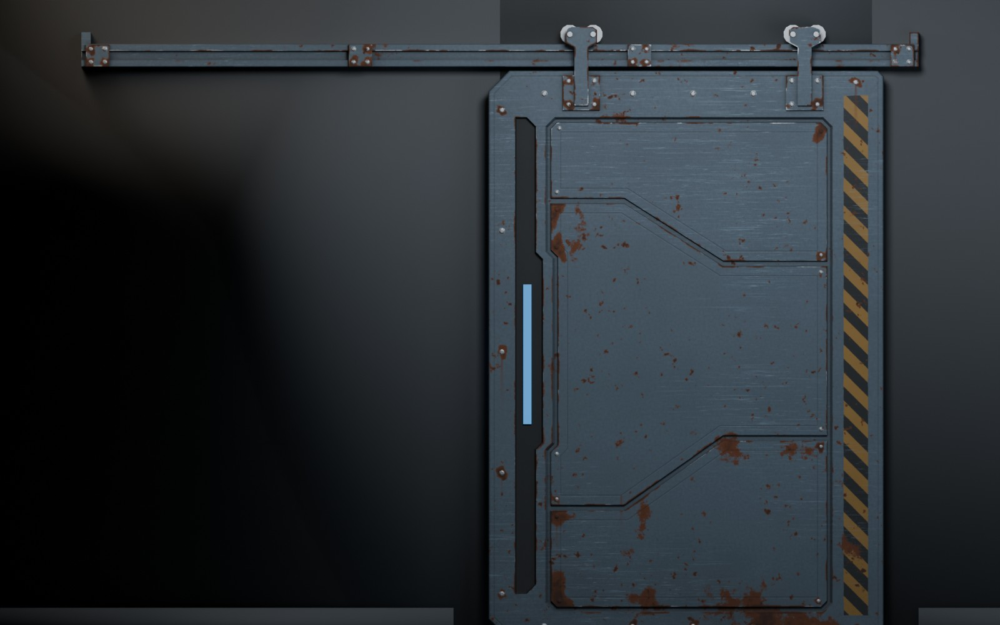
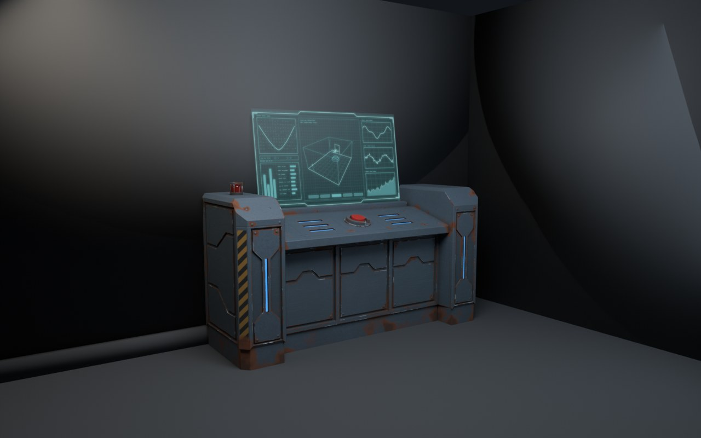
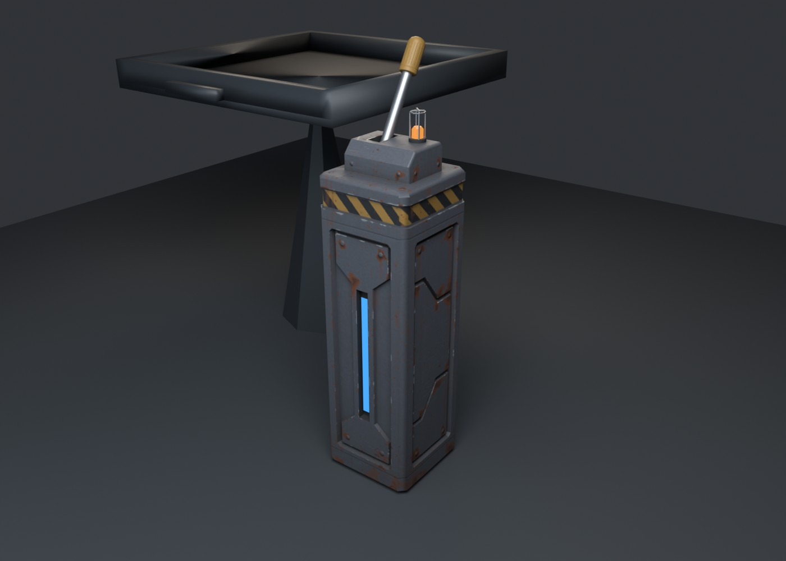
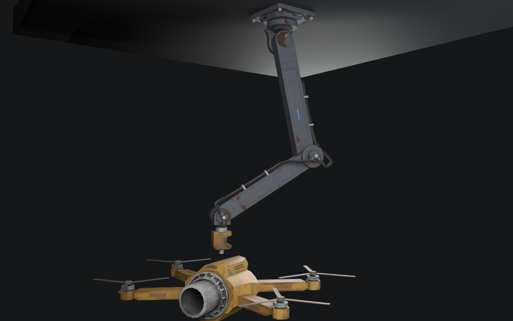

# Labyrinth VR — Industrial Robotics Research Facility

**A VR game for Meta Quest 3S.** The player tilts a labyrinth board by its handle to roll a ball
into the goal hole, while a hovering drone shoots at the ball. The game is set in a compact
"Industrial Robotics Research Facility": a lab room, a corridor and a short launch sequence in which
the player opens the facility gate, arms the room at a terminal and pulls a lever to release the
drone from its docking cradle.

The game comes first. The environment, hero assets and tools are built around it, to the standards
a standalone VR headset needs.


---

## My role — Shayan Hassani

- **Game and level design:** the gameplay, the room layout, the launch sequence (gate → terminal →
  lever → drone release) and the labyrinth control model.
- **Art direction:** visual direction, palette, wear and rust rules (dark painted metal, black
  polymer, cyan/blue emissive accents, drone-yellow warning accents; edge wear, grime and rust are
  part of the style for every asset), concept images, and approval of every hero design on review
  renders.
- **Specs and quality rules:** I define the rules the project is built to: asset tiers, topology,
  UV and texel-density targets, bake and texture rules, the export contract, and per-hero specs with
  exact sizes, pivots and clearances. The documents are drafted with AI assistance; I review and
  approve every rule.
- **Texturing** in Substance Painter (docking cradle).
- **Directing an AI-assisted pipeline:** AI tools write code and drafts under my direction. I set
  the design, the rules and the acceptance criteria, and I review every step before it is accepted.

## Tech

| Area | Tools |
|---|---|
| Engine | Unity 6 (6000.3 LTS), URP 17.3, C# |
| XR | OpenXR 1.16 (Meta Quest feature), XR Interaction Toolkit 3.3, Input System; target Android / Meta Quest 3S |
| 3D | Blender 5.2 with headless Python scripting (procedural generators, validators, bakes) |
| Texturing | Substance Painter; procedural Blender materials baked in Cycles |
| AI | Gemini (concept and reference images), Claude Code (code and drafts), Hunyuan 3D (shape reference for the cradle) |
| Version control | Git, Git LFS (binary art under `Assets/Environment/`) |

## Pipeline

```
Concept ─► Spec ─► Blender generator (Python, headless) ─► Automated checks ─► Texture bakes
        ─► FBX export (EXPORT_CONTRACT) ─► Unity import + Editor builders ─► Quest 3S
```

1. **Concept and spec.** Concept images (Gemini) for look; all sizes, pivots, motion ranges and
   clearances are fixed in [`HERO_SPEC.md`](Documentation/HERO_SPEC.md) and
   [`ENVIRONMENT_SPEC.md`](Documentation/ENVIRONMENT_SPEC.md). The spec wins over the concept.
2. **Procedural generators.** Every hero and the modular kit are built by Blender Python scripts
   (`Tools/Blender/`): low-poly by construction, quads in the working file, real chamfers on large
   edges, custom normals, one FBX per moving part with its origin on the hinge.
3. **Automated validation** (headless, short PASS/FAIL output). Checks found in `Tools/` and
   [`ASSET_RULES.md`](Documentation/ASSET_RULES.md):
   - **Topology:** triangle counts per part, n-gons, non-manifold, loose, duplicate and zero-area
     elements, hidden-face removal (ray visibility test) and a hole test, bow-tie / concave quads,
     winding against the custom normals, planarity report.
   - **Shading:** no flat face with a corner normal more than 0.5° off its face normal.
   - **UVs:** island count, texel density, padding (8 px between islands, 4 px to the border),
     overlaps, packing %.
   - **Clearance sweeps:** moving parts swept over their full motion against the drone, the room
     and each other (cradle fold 0–75°, gate slide, button press).
   - **AI-reference deviation** (cradle): low-poly vs fitted AI shape, with every over-limit area
     classified.
   - **Bakes:** cage both ways and ID per feature (high-poly workflow); AO black scan; PBR value
     ranges; normal-map seam check.
   - **Export:** triangulated export copy with preserved custom normals and MikkTSpace tangents, so
     the same file goes to texturing and to Unity.
   - Review renders (shaded, wireframe, UV layout, texel checker) for the artistic review.
4. **Texture bakes.** Cradle: clean high-poly bake, textured in Substance Painter. Later heroes
   ("hero workflow v3"): procedural Blender materials baked in Cycles onto the low-poly itself —
   BaseColor (sRGB), Normal (OpenGL), Mask (R metallic, G AO, A smoothness), Emission.
5. **Unity import** per [`EXPORT_CONTRACT.md`](Documentation/EXPORT_CONTRACT.md): 1 unit = 1 m,
   axis conversion baked into the mesh (Unity's X mirror cancelled in authoring), identity root
   transforms, imported normals and tangents. Editor builders assemble the scene from data tables
   (`GreyboxBuilder`, `LabyrinthBuilder`, `CradleBuilder`, and one builder per hero: Gate, Terminal,
   LeverStand, ServiceArm), each with a Verify step.
6. **Quest 3S** is the runtime authority: Editor results are not accepted as proof.

### Standalone-VR budgets and targets (from `ASSET_RULES.md`)

| Item | Target |
|---|---|
| Hero texel density | 512 px/m at 2048 (heroes > 2 m on one 2048 set: ≥ 400 px/m), ±10 % |
| Labyrinth panel/handle · secondary props | 1024 px/m · 256 px/m |
| Texture sets | one texture set (one material) per hero where possible — fewer draw calls, SRP Batcher |
| Texture size | heroes authored at 2048, may ship at 1024 after the Quest test; secondary ≤ 1024; power of two |
| Compression | ASTC on Android (start 6×6 colour/mask, 4×4 normal), mipmaps on |
| Geometry | detail ≥ 15 mm is geometry (stereo depth), smaller detail goes to the normal map; round parts 32 / 16 / 8–12 segments by diameter |
| LODs | none unless a hero exceeds ~10k triangles (decision documented per asset) |
| Colliders | primitives only, never the render mesh |
| Greybox | plain wall panel under ~100 triangles |
| PBR | non-metal albedo sRGB 30–240, metal ≥ 180, metallic 0 or 1 except wear transitions |

The Quest performance baseline (FPS, GPU time, thermals) is planned but not yet recorded.

## Highlights

- **Drone (existing game enemy):** 2,114 triangles in 14 meshes, one material on a custom Shader
  Graph (`SG_DroneOptimized`), 2048 textures. The firing flash drives emission through a
  `MaterialPropertyBlock`, so no material copies are created at runtime.
- **Labyrinth control:** "pan model" — lift the handle to tilt forward/back, twist the wrist to
  tilt sideways; the tilt is clamped to a 12° cone and driven through a kinematic Rigidbody so the
  ball gets real surface motion. Covered by 7 EditMode tests (`LabyrinthTiltTests`).
- **Docking cradle (hero):** 3,876-triangle low-poly built by script to measurements taken from an
  AI shape reference, one 2048 texture set at 438 px/m, fold checked over 0–75° against the docked
  drone.
- **Facility gate (hero):** 1,736 triangles, one 2048 set at 487 px/m, 88 baked bolts, clearance
  checked over the whole slide, textures baked from procedural Blender materials.
- **Control terminal (hero):** 1,958 triangles, one 2048 set plus a see-through holo screen; the
  Armed state switches three indicator strips and the beacon to red through `MaterialPropertyBlock`s
  (no material copies). Every part checked against a camera-matched comparison with the concept.
- **Lever stand (hero):** 1,100 triangles on one 1024 set, the hand-held lever at 2× texel density;
  hinge-only grab that follows the hand without a jump, locked / armed / pulled states with a
  "denied" cue; tilt-clearance sweep against the labyrinth board.
- **Ceiling service arm (hero):** 5,254 triangles, six rigid links; working pose solved by IK, a
  procedural non-repeating idle and a 2 s fold. Swept over 1,952 poses against the docked drone's
  spinning-propeller volumes, the drone mesh, the cradle and itself.
- **Export contract:** found and documented a silent X-mirror on FBX import that a symmetric test
  asset had hidden; every verification batch now includes an asset that is asymmetric on each axis.

## Status and roadmap

| Item | Status |
|---|---|
| Greybox room + corridor, teleport floor | Built, tested on Quest |
| Labyrinth v2 (panel, handle, stand, tilt control) | Built, tested on Quest; tuning backlog L1–L3 |
| **Cradle** (docking cradle) | Low-poly, UVs, high-poly and final bake done; texturing in Substance Painter and Unity import of v2 next |
| **Gate** (facility gate) | Modelled, textured (G2c), FBX, builder and runtime scripts done; Unity import and Quest check in progress |
| **Terminal** (control terminal) | Modelled, textured (H2b), FBX, builder and runtime scripts done; Unity import and Quest check in progress |
| **LeverStand** (release lever) | Modelled, textured, FBX, builder and runtime scripts done; Unity import and Quest check in progress |
| **ServiceArm** (ceiling service arm) | Modelled, textured (H2b, chunkier arm), FBX, builder and runtime scripts done; clearance PASS against drone and cradle; Unity import and Quest check in progress |
| Launch-sequence wiring (`FacilitySequence`), lighting states, secondary props | Planned |
| Quest performance baseline | Planned |

## Repository structure

```
Assets/
  Environment/        new environment work (Git LFS for binaries)
    Editor/           GreyboxBuilder, LabyrinthBuilder, CradleBuilder, hero builders (Editor C#)
    Heroes/           hero FBX files
    Kit/              modular greybox kit (walls, floor, ceiling, pillar, trim)
    Materials/        greybox materials
    Props/            labyrinth panel, handle, stand
  Scripts/            gameplay C# (drone AI, labyrinth tilt and goal, projectile)
    Facility/         hero runtime scripts (gate slide, buttons, terminal, lever, service arm)
  Tests/              EditMode tests
  Scenes/             BasicScene (game), RenderScene (look-dev), SampleScene
  Drone_Asset/, Materials/, Shaders/   drone model, materials and Shader Graphs
Documentation/        specs, rules, contract, devlog, proposals and reviews
Tools/Blender/        kit generator; heroes/ = hero generators, checks, bakes
Packages/, ProjectSettings/
```

Key documents: [ASSET_RULES](Documentation/ASSET_RULES.md) ·
[STYLE_GUIDE](Documentation/STYLE_GUIDE.md) · [HERO_SPEC](Documentation/HERO_SPEC.md) ·
[EXPORT_CONTRACT](Documentation/EXPORT_CONTRACT.md) ·
[ENVIRONMENT_SPEC](Documentation/ENVIRONMENT_SPEC.md) · [DEVLOG](Documentation/DEVLOG.md) ·
[Pipeline V9](Documentation/PIPELINE_V9.md)

## Screenshots

Review renders (Blender Cycles, baked textures on the export low-poly).






## AI disclosure

AI tools are part of the workflow and are disclosed: Gemini for concept and reference images,
Hunyuan 3D as a shape and measurement reference for the cradle (no AI geometry ships), and Claude
Code for code and document drafts (including the specs and rule documents) under my direction.
Design, rules, review and acceptance are mine.

## Contact

- LinkedIn: [www.linkedin.com/in/shayan-hassani](https://www.linkedin.com/in/shayan-hassani)
- Portfolio: [shayanhassanime.wixsite.com/shayan-hassani](https://shayanhassanime.wixsite.com/shayan-hassani)
